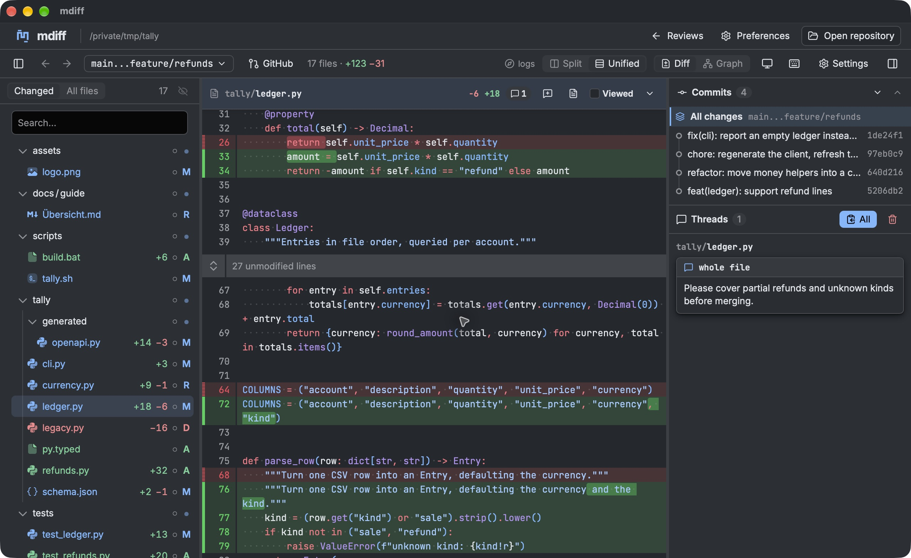

# mdiff

mdiff is a native code review app for macOS and Linux. Review local changes, GitHub pull requests, and GitLab merge requests with split or unified diffs, threaded feedback, code navigation, and customizable themes and fonts.

[](https://github.com/MohamedElashri/mdiff/actions/workflows/check.yml)
[](https://github.com/MohamedElashri/mdiff/actions/workflows/release.yml)
[](https://github.com/MohamedElashri/mdiff/releases/latest)
[](LICENCE.md)



## Quick start

macOS with [Homebrew](https://brew.sh):

```sh
brew tap MohamedElashri/mdiff https://github.com/MohamedElashri/mdiff && brew install --cask MohamedElashri/mdiff/mdiff
```

Update with `brew upgrade --cask --greedy MohamedElashri/mdiff/mdiff`.

macOS or Linux without Homebrew:

```sh
curl -fsSL https://raw.githubusercontent.com/MohamedElashri/mdiff/main/install.sh | bash
```

Installs to `~/Applications` on macOS or `~/.local/bin` on Linux, with an application menu entry. Supports Apple Silicon, Intel Macs, and Linux x86_64 (Ubuntu 24.04 or compatible, with FUSE 2). Downloads are checksum-verified. [Manual downloads](https://github.com/MohamedElashri/mdiff/releases).

Open mdiff, choose **Open repository**, and select a Git folder. Use **New review** for another comparison or a PR/MR URL. Configure appearance and connections in **Preferences**; press `?` for review shortcuts.

Git is required. Code intelligence needs a language server. Connection tokens stay in memory until you quit. GitLab supports HTTPS hosts and custom ports; installations under URL subpaths are not supported.

## Build

Requires Node.js 26, Rust 1.99, and [Tauri prerequisites](https://v2.tauri.app/start/prerequisites/).

```sh
make setup
make dev              # native app with live reload
make build            # desktop packages
make check            # lint, types, tests, and frontend build
make help             # all commands
```

Use `make build-debug` for a debug app, or `make build TARGET=x86_64-apple-darwin BUNDLES=app` for a specific installed Rust target. Signed packages use `make build-signed` with the updater signing environment variables; publishing remains tag-driven in GitHub Actions.

## License

[GPL-3.0-only](LICENCE.md).
