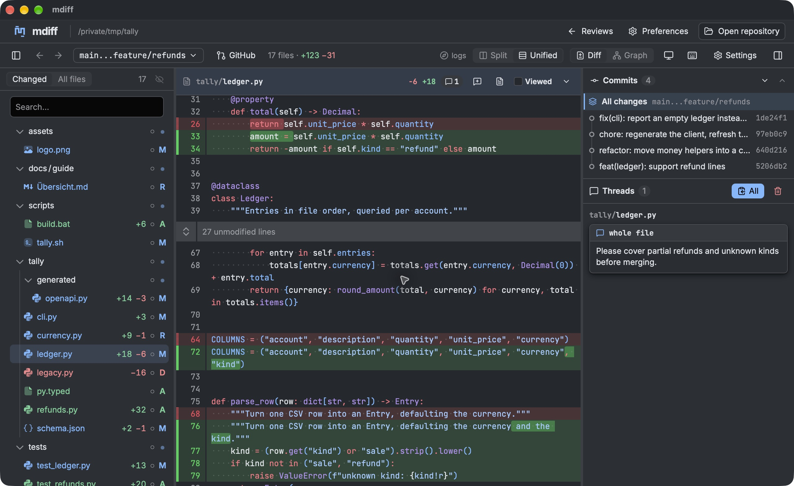

# mdiff

mdiff is a native code review app for macOS and Linux. Review local changes, GitHub pull requests, and GitLab merge requests with split or unified diffs, threaded feedback, code navigation, and customizable themes and fonts.

[](https://ko-fi.com/melashri)

[](https://github.com/MohamedElashri/mdiff/actions/workflows/check.yml)
[](https://github.com/MohamedElashri/mdiff/actions/workflows/release.yml)
[](https://github.com/MohamedElashri/mdiff/releases/latest)
[](LICENCE.md)



## Quick start

macOS with [Homebrew](https://brew.sh):

```sh
brew tap MohamedElashri/mdiff https://github.com/MohamedElashri/mdiff && brew install --cask MohamedElashri/mdiff/mdiff
```

Update with `brew upgrade --cask --greedy MohamedElashri/mdiff/mdiff`.

macOS or Linux without Homebrew:

```sh
curl -fsSL https://raw.githubusercontent.com/MohamedElashri/mdiff/main/install.sh | bash
```

Installs to `~/Applications` on macOS or `~/.local/bin` on Linux, with an application menu entry. Supports Apple Silicon, Intel Macs, and Linux x86_64 (Ubuntu 24.04 or compatible, with FUSE 2). Downloads are checksum-verified. [Manual downloads](https://github.com/MohamedElashri/mdiff/releases).

> **macOS:** mdiff is not signed with an Apple Developer ID or notarized by Apple. If macOS blocks a copy downloaded from this repository's releases, remove its quarantine attribute:
>
> ```sh
> xattr -dr com.apple.quarantine /Applications/mdiff.app
> ```
>
> For script installs, use `"$HOME/Applications/mdiff.app"` instead of `/Applications/mdiff.app`.

Open a repository or a PR/MR URL. Press **Cmd/Ctrl+K** for the command palette and `?` for review shortcuts. Use **Preferences** for appearance, review defaults, connections, code intelligence, agents, terminal tools, and monitoring.

## Features

- Split/unified diffs, images, threaded feedback, search, and optional code intelligence.
- [Tabs and workspaces](src/workspaces/README.md) with saved drafts, reopen/unload actions, and up to two windows.
- [Commit history](vendor/diffle/src/client/history/README.md) with filters, parent comparisons, ranges, and commit series.
- [Git operations](src/git-operations/README.md), staging, commits, branches, worktrees, and [conflict recovery](src/git-operations/advanced.md).
- [Pull & merge requests](src-tauri/src/hosting/README.md) for GitHub/GitLab reviews, discussions, revision-specific checks, and supported review/merge actions.
- [Worktrees and external tools](src/worktrees/README.md), plus an optional [embedded terminal](src/terminal/README.md).
- Opt-in [agent activity and review handoffs](src/agents/README.md) and an [attention inbox](src/attention/README.md) with notifications and tray access.
- Configurable shortcuts, themes, fonts, compact density, and [language selection](vendor/diffle/src/client/i18n/README.md) with a partial French preview. Restart to apply a language change.

## Connections and trust

Git is required. Code intelligence requires an installed language server and explicit trust for each opened review. Trust is not restored across reviews or restarts.

Connection tokens stay in memory and are bound to their host. Manual Git network operations use your Git credentials/helpers and SSH agent. GitLab supports HTTPS and custom ports; URL subpaths are unsupported.

Saved feedback and drafts are independent of temporary PR/MR checkouts. Edited checkouts are retained for recovery. See [review storage](src-tauri/src/reviews.md) and [platform validation](VALIDATION.md) for behavior and limits.

## Build

Requires Node.js 26, Rust 1.99, and [Tauri prerequisites](https://v2.tauri.app/start/prerequisites/).

```sh
make setup
make dev              # native app with live reload
make build            # desktop packages
make check            # lint, types, tests, and frontend build
make help             # all commands
```

Use `make build-debug` for a debug app, or `make build TARGET=x86_64-apple-darwin BUNDLES=app` for a specific installed Rust target. Signed packages use `make build-signed` with the updater signing environment variables; publishing remains tag-driven in GitHub Actions.

## Support

Tips are optional and help maintain the project.

**[Leave a tip on Ko-fi](https://ko-fi.com/melashri)** · [Project website](https://melashri.net/software/mdiff/)

## License

[GPL-3.0-only](LICENCE.md).
